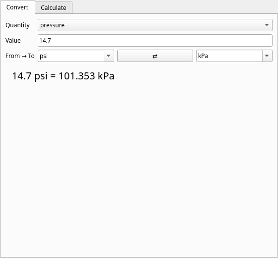
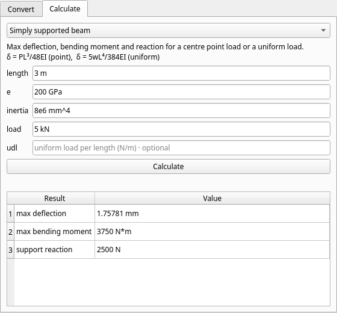

# knvrt

[](https://github.com/LordCheta/knvrt/actions/workflows/ci.yml)


Unit conversions and everyday engineering calculators. Use it as a **Python library**, a **command-line tool**, or a small **desktop app**.

It started in 2019 as an empty "simple common engineering calculations" idea. This version is a rewrite around a real unit engine: every unit carries a physical dimension, so `knvrt` refuses nonsense (kilograms to metres) instead of returning a number.

| Convert | Calculate |
| --- | --- |
|  |  |

## Install

```bash
pip install .            # library + CLI, no dependencies
pip install '.[gui]'     # adds the PySide6 desktop app
```

Python 3.10 or newer.

## Command line

```console
$ knvrt convert 5 km mi
5 km = 3.10686 mi
$ knvrt convert 60 mph m/s
60 mph = 26.8224 m/s
$ knvrt convert 100 degC F
100 degC = 212 F
$ knvrt convert 1 kWh MJ
1 kWh = 3.6 MJ
$ knvrt convert 5 kg m
error: Cannot convert mass (kg) to length (m)
```

Compound units work with `*`, `/` and `^`: `km/h`, `N*m`, `kg*m^2/s^2`, `W/m/K`. SI prefixes (`k`, `M`, `m`, `µ`/`u`, `n`, …) apply to the SI units; `knvrt units` lists every unit.

```console
$ knvrt calc
  ohms-law               Solve voltage, current, resistance and power from any two.
  ...
$ knvrt calc ohms-law v='12 V' r='470 ohm'
voltage    = 12 V
current    = 0.0255319 A
resistance = 470 ohm
power      = 0.306383 W
$ knvrt calc beam-simply-supported length='3 m' e='200 GPa' inertia='8e6 mm^4' load='5 kN'
max deflection     = 1.75781 mm
max bending moment = 3750 N*m
support reaction   = 2500 N
$ knvrt calc pipe-flow --help        # formula, inputs and default units
$ knvrt calc pipe-flow flow='2 L/s' diameter='50 mm' density=998 viscosity=0.001 --json
```

A bare number uses the calculator's default unit; a quantity with a unit may use any compatible unit (`force='2248 lbf'`). Mistakes exit with status 2 and a one-line `error:` message, never a traceback. `--json` gives machine-readable output and `--digits N` changes the precision.

### Calculators

| Name | What it does |
| --- | --- |
| `ohms-law` | Any two of V, I, R, P give the other two |
| `resistors-series`, `resistors-parallel` | Total resistance of up to six resistors |
| `voltage-divider` | Output voltage and current of a two-resistor divider |
| `axial-stress` | σ = F/A, plus a safety factor if you give a yield strength |
| `beam-simply-supported` | Deflection, bending moment and reaction for a centre point load or a uniform load |
| `beam-cantilever` | Tip deflection and fixed-end moment for a tip load or a uniform load |
| `section-rectangle`, `section-circle` | Area, second moment of area and section modulus (hollow circles supported) |
| `pipe-flow` | Mean velocity and Reynolds number, with the laminar / transitional / turbulent regime |
| `conduction` | Steady heat flow through a flat wall, Q = kAΔT/L |
| `shaft-power` | P = Tω from torque and rpm |
| `gear-ratio` | Ratio from tooth counts |
| `projectile` | Range, flight time and peak height, optionally from a launch height |

Each expected value in the test suite was worked out by hand from the textbook formula, not copied from the code's own output.

## Library

```python
from knvrt import convert, Quantity, CALCULATORS

convert(5, "km", "mi")  # 3.1068559611866697
convert(100, "degC", "F")  # 212.0

p = Quantity.of(14.7, "psi")
p.to("kPa")  # 101.35293220957489
p.si  # 101352.93... (always SI base units)

for out in CALCULATORS["ohms-law"].run({"v": "12 V", "r": "470 ohm"}):
    print(out.name, out.value, out.unit)
```

`UnitError` and `CalcError` (both `ValueError`s) carry readable messages. The package is typed (`py.typed`) and checked with `mypy --strict`.

## Desktop app

```bash
pip install '.[gui]'
knvrt gui
```

A converter tab that updates as you type, and a calculator tab whose form is generated from the same registry the CLI uses, so there is one implementation of the maths and three front ends.

## How it works

* `dimensions.py`: a `Dimension` is an exponent vector over length, mass, time, current and temperature. Multiplying and dividing units adds and subtracts exponents, which is why `N*m` and `J` compare equal and `N` and `J` do not.
* `units.py`: a registry of units with an SI scale factor, SI-prefix handling, and a parser for compound expressions. Temperature scales are affine (they have an offset), so they are handled separately from the multiplicative units. A lone `C` is the coulomb, but next to another temperature scale (`knvrt convert 100 C F`) it means Celsius.
* `calculators.py`: each calculator declares its inputs (with a dimension and a default unit), converts everything to SI, computes, and reports in friendly units.

## Development

```bash
python -m venv .venv && . .venv/bin/activate
pip install -e '.[dev]'
ruff check . && ruff format --check . && mypy
QT_QPA_PLATFORM=offscreen pytest      # the GUI test skips itself if PySide6 is absent
```

The suite has unit tests, hypothesis property tests (round trips, linearity, "parallel is smaller than the smallest resistor"), CLI tests and an offscreen GUI test. CI runs it on Python 3.10 to 3.13 and builds the wheel.

## Project history and notes

* 2019: the repository started as a PySide2 stub. That stub, its Pipfile (Python 3.6, PySide2) and `main.py` were removed because they no longer install on supported Pythons.
* A `.vscode/settings.json` was committed by mistake in 2019 and deleted a few commits later (the commit message says "Private file"). It only holds a local interpreter path, no credentials, and it is now git-ignored. It remains visible in early history.

## Licence

GPL-3.0-or-later, as in the original repository. See [LICENSE](LICENSE). Created by Lord Cheta (Chxta Inc).
